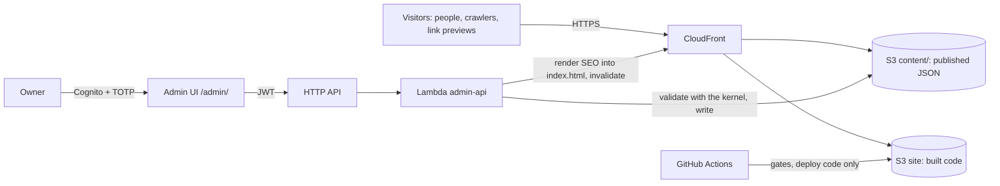

# Architecture

The living overview of how the code is organised and which rules are in force. Update it in the same change that moves a boundary. Reasoning lives in the ADRs (`docs/decisions/`) and in `specs/010-architecture/`; this page only states what is true now and what is next.

**Migration status (2026-10-13):** done. P0 to P4 built, and the normalization stage of ADR 007 closed after the second independent audit (`specs/010-architecture/audit-2.md`, resolution in section 13 of the spec). The compositions stage (spec 011, ADR 008) is under way: since S2 (2026-10-15) desktop shows the stage, one template per face read from the content; stacked screens keep the rails until S4. Then content, security and the release.

## System



Today only the left half exists in AWS (S3 and CloudFront, `infra/`). The admin runs locally (`server/`, NestJS) and publishes to disk; the Cognito path is ADR 004, in progress.

Two layers: the repository holds code and example content; the owner's content is private, gitignored locally (`public/content/site.{en,es}.json`, `visual.json`) and reaches the site only through the admin.

## Repository

| Path | What | Notes |
|---|---|---|
| `src/` | Public site: React 19, TypeScript, Vite, React Three Fiber, Tailwind v4 | One package with the admin server; `@/` is `src/` |
| `src/kernel/` | Content kernel: render schemas, the composition templates and the icon catalog (`compositions.ts`, `icons.ts`), publish rules and layout budgets (`publishRules.ts`, `layoutBudgets.json`, per template since spec 011), face and world catalogs, defaults (the bundled example), SEO renderer | ADR 005 |
| `server/` | Local NestJS admin, `127.0.0.1:5182` | Retired by ADR 004 slice 6; imports only `src/kernel`; linted and type-checked |
| `infra/` | AWS CDK | Own `package.json`, lockfile and TypeScript version |
| `scripts/` | Gate scripts (`check-*.mjs`) and their data in `scripts/checks/` | Known layout failures, budget ratchet, deploy test |
| `docs/`, `specs/` | Direction, ADRs, specs | `AGENTS.md` is the constitution |

## Site modules

```
src/
  app/               composition: App (home or dev showcase), Experience (store + page), IdentityChrome
  features/
    experience/      the experience store: state, typed events, reducer (experienceStore.ts);
                     face transition, intro lifecycle, face in the URL, intro planning
    scene/           R3F: SceneLayer (canvas, still-image fallback, wiring to the store),
                     CubeScene, PremiumCube, environment, intro timeline, vector worlds
    stage/           the desktop layout (spec 011): StageView (top bar, content, dock), StageComposition
                     and one component per template in templates/, each with its stylesheet
    faces/           FaceRails (the two rails, stacked screens until spec 011 S4), FeatureGlyph, DetailDialog
    navigation/      FaceStrip, RotateHint
    content/         loaders, locale, sanitizer, RichText, interface copy dictionary
    audio/           the gesture-driven cube sounds (no autoplay), used by the scene
    dev/             world showcase and its shortcut (development only)
  ui/                Tailwind primitives: SegmentedControl, Eyebrow, GlyphTile, NumberBadge, PillButton, cx
  styles/            tokens.css (tokens, layout-mode variants), layoutModes.ts (their single source)
  lib/               React utilities any layer may use: ErrorBoundary, hasWebGL, useViewportSize
  kernel/            the content contract (ADR 005)
```

Hand-written CSS, each file commented with why: `src/app/shell.css` (the page's gradients and grid, the canvas box), `src/app/intro.css` (the intro choreography, deliberately unlayered), `FaceRails.css`, `FaceStrip.css`, `DetailDialog.css` (layered gradients, decorations, choreography), `src/ui/ornaments.css`, and the stage's `stage.css` with one stylesheet per template (the stage is sized in em from a font size that follows the viewport, which utilities express poorly). `stage.css` loads before the templates' sheets, which refine it. The dev showcase's stylesheet travels only with its development chunk. There is no global stylesheet besides `src/index.css` (Tailwind, tokens, base layer).

**Layout modes.** Three modes decide the composition: `desktop` (the stage: the face's composition around the cube, the dock at the bottom), `desktop-short` (the same on a short screen) and `stacked` (cube on top, the page scrolls). Six width refinements adjust inside them: `stacked-wide` (tablet landscape), `tight` (≤ 1100px, narrower rails), `narrow` (≤ 720px, phone-sized stacked page), `phone` (≤ 680px, the strip takes two rows), `phone-small` (≤ 389px, one-column research map) and `tiny` (≤ 340px, the tightest strip). They are the breakpoints of the CSS before the migration, kept so the migration changed no pixel; merging `narrow` and `phone` is a design change for a visual review, not a normalization. All nine queries live in `src/styles/layoutModes.ts`; Tailwind's own breakpoints are removed, so there is no other way to write one.

**How the scene and the interface meet.** Neither imports the other. Both read the experience store and dispatch its events: the strip dispatches `faceRequested`; the scene turns the cube and dispatches `faceEntered` when it lands (without a scene the store changes the face at once); the rails follow `displayedFace` through the transition; the intro's landing, settling and skipping are events too. The reducer is pure and unit-tested (`experienceStore.test.ts`).

**Dependency rules** (in force, `eslint.config.js`, tested by `scripts/checks/boundaries.test.ts`):

| Module | Must not import |
|---|---|
| `kernel` | anything but `zod`, its own files and the committed example content; no lazy loading |
| `lib`, `styles` | anything under `@/` |
| `ui` | features, app, three, R3F |
| `features/experience` | other features, ui, app, three, R3F |
| `features/scene` | faces, navigation, content, dev, ui, app |
| `features/faces`, `features/navigation`, `features/stage` | scene, audio, dev, app, three, R3F; the stage also writes no text in its markup (spec 011, AD-07) |
| `features/content` | other features, ui, app, three; no lazy loading |
| `features/audio` | anything under `@/` |
| `features/dev` | app; no lazy loading |
| `app` | — |

Imports across top-level modules use `@/`; a relative path that climbs into another module is an error. Interface code does not compare locales (strings come from `features/content/copy.ts`) and does not load code lazily (only the scene's worlds and the app's dev showcase do).

## Flows

- **Build-time SEO.** `vite.config.ts` (`seoFromContent`) reads `public/content/site.en.json`, or the committed example if absent, and renders the head tags, JSON-LD and a plain-text body into `index.html` with `src/kernel/seo/renderSeo.ts`. CI has no private content, so a CI build carries the example identity.
- **Content at runtime.** The site renders the bundled example first, fetches `content/site.{locale}.json` and `content/visual.json` (`src/features/content/loadContent.ts`), validates them with the kernel, and keeps the example when a document is absent, not JSON or invalid. Empty fields of a published face are filled from the example in the same language.
- **Publish (today).** The local admin validates with `PublishableSiteContentSchema` (the render schema plus layout budgets, link rules and no example placeholders) and writes `public/content/*.json` on disk. Not production. The site itself loads with the tolerant render schema, so content published under older rules keeps rendering.
- **Publish (target, ADR 004).** Lambda validates with the kernel, writes to `content/` in the site bucket, renders SEO into `index.html`, invalidates.
- **Deploy.** `deploy.yml` builds, uploads the hashed `assets/` without deleting old chunks, then syncs the rest with `--delete` excluding `content/*` and `assets/*` (AD-11). **Known gap:** CloudFront still rewrites 403/404 to `index.html` with status 200 (AD-09); removed in the publish track, together with the lifecycle rule for old chunks.

## Rules and their gates

| Rule | Status | Gate |
|---|---|---|
| Personal data never in the repository | In force | `.gitignore`; `npm run check:privacy` in CI and pre-push (H-08a); `--history` (authors, messages and the content of every past version) before publishing a repository |
| Build, lint and unit tests pass; tests are type-checked | In force | CI; `tsconfig.test.json` in `tsc -b` |
| CDK synthesises | In force | CI |
| Server linted and type-checked | In force | `npm run lint`, `npm run typecheck:server` (H-05) |
| Kernel pure, server imports only the kernel | In force | `tsconfig.kernel.json` in `tsc -b`, lint rules in `eslint.config.js` (H-15, H-04b); the rules themselves are tested by `scripts/checks/boundaries.test.ts` |
| Owner content wins; a missing field falls back to the example in the same language | In force | `src/kernel/siteContent.test.ts` |
| Every public asset has a recorded source and licence | In force, two pending | `docs/assets.md`, `scripts/checks/assets.test.ts` |
| Layout: no rail over the strip, CTAs in view, name first and not covered, fixed chrome never overlaps; name and role at AA contrast over the real background | In force, no known failures | `npm run check:layout` (H-06) |
| Stage: every block of a composition fits its area without scrolling, nothing painted over another block, the chrome or the content inside a block, the centre clear for the cube, CTAs in view | In force, no known failures | `npm run check:layout` on desktop viewports (spec 011, AD-06) |
| Every text slot of a template reaches the page | In force | `src/features/stage/StageComposition.test.tsx` |
| Content within its layout budget fits every supported screen | In force, every template included (budgets measured 2026-10-15) | `npm run check:layout -- --content=stress` (H-06b); publish rules in `src/kernel/publishRules.ts`, tested by `scripts/checks/stressContent.test.ts` |
| One source for layout modes; no numeric breakpoints or loose width variants in components | In force | `src/styles/layoutModes.test.ts` (H-17) |
| No blank page without WebGL or when a world fails | In force | Degradation checks in `npm run check:layout` (H-18) |
| Accessibility: no axe violations | In force, no known failures | `npm run check:layout` (H-13) |
| Security headers (CSP, HSTS, nosniff, frame and referrer policy); no inline code in `index.html` | In force: enforced in `vite preview` and the layout check, report-only in CloudFront | `infra/security-headers.json`; violations fail `npm run check:layout`; `scripts/checks/indexHtml.test.ts` |
| First-view budget, ratchet that only goes down; built first-view files preloaded | In force | `npm run check:budget`, limit in `scripts/checks/budget.json` (H-07) |
| Deploy never deletes content, and runs only after a green CI | In force | `scripts/checks/deployWorkflow.test.ts` (H-14) |
| Colours only from tokens (no default palette, no literals, no unused token); base type only from type roles | In force | `npm run check:tokens` (H-08b) |
| Module boundaries; no locale comparisons or lazy loading in interface code | In force | `npm run lint`, rules tested by `scripts/checks/boundaries.test.ts` (H-04) |
| DOM-layer files ≤ 250 lines | In force | `scripts/checks/fileSize.test.ts` (H-16) |
| The served font is the one measured (Inter) | In force | `font-not-loaded` in `npm run check:layout` (AD-10) |
| Living docs carry no undated measurements | In force | `npm run check:docs` (H-11) |
| Architecture doc updated with boundary changes | Unchecked | PR template |
