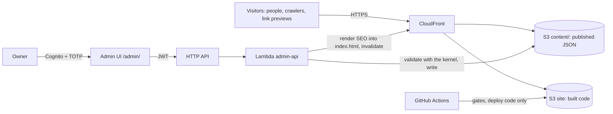

# Architecture

The living overview of how the code is organised and which rules are in force. Update it in the same change that moves a boundary. Reasoning lives in the ADRs (`docs/decisions/`) and in `specs/010-architecture/`; this page only states what is true now and what is next.

**Migration status (2026-10-12):** P0 done. Next: P1 (gates and kernel). Phases are defined in `specs/010-architecture/spec.md`, section 7.

## System



Today only the left half exists in AWS (S3 and CloudFront, `infra/`). The admin runs locally (`server/`, NestJS) and publishes to disk; the Cognito path is ADR 004, in progress.

Two layers: the repository holds code and example content; the owner's content is private, gitignored locally (`public/content/site.{en,es}.json`, `visual.json`) and reaches the site only through the admin.

## Repository

| Path | What | Notes |
|---|---|---|
| `src/` | Public site: React 19, TypeScript, Vite, React Three Fiber, Tailwind v4 | One package with the admin server |
| `src/kernel/` | Content kernel: schemas, catalog, defaults, example, SEO renderer, budgets | **Target, P1** (ADR 005). Today: `src/features/premium-cube/content/` and `src/seo/` |
| `server/` | Local NestJS admin, `127.0.0.1:5182` | Retired by ADR 004 slice 6; may import only `src/kernel` (from P1) |
| `infra/` | AWS CDK | Own `package.json`, lockfile and TypeScript version |
| `docs/`, `specs/` | Direction, ADRs, specs | `AGENTS.md` is the constitution |

## Site modules

**Today:** everything under `src/features/premium-cube/` (one folder), plus `src/seo/`, `src/App.tsx`, `src/App.css`, `src/index.css`. `PremiumCubePrototype.tsx` owns most behaviour.

**Target** (ADR 006; folders appear in the phase noted):

```
src/
  app/               composition, error boundaries                     P2a (boundaries), P3
  features/
    experience/      store and typed events                            P3
    scene/           R3F scene, intro, worlds, environment              P3 (moved as is)
    faces/           rails, evidence, flow, research map, dialog        P3
    navigation/      face strip, language switch, contact links         P3
    content/         loaders, sanitizer, UI copy dictionary              P1 (loaders), P3
    audio/  dev/     ambient sound; diagnostics and showcase (DEV only)  P3
  ui/                Tailwind primitives                                P2b
  styles/            tokens.css, scene.css, layoutModes.ts              P2a (layoutModes), P2b
  kernel/            ADR 005                                            P1
```

Dependency rules (target, linted from P3): `kernel` imports only `zod`; `ui` imports no feature, three or R3F; `scene` and the DOM features (`faces`, `navigation`) never import each other and meet in `experience`; `experience` imports only `kernel`; `app` may import everything.

## Flows

- **Build-time SEO.** `vite.config.ts` (`seoFromContent`) reads `public/content/site.en.json`, or the committed example if absent, and renders the head tags, JSON-LD and a plain-text body into `index.html` with `src/seo/renderSeo.ts`. CI has no private content, so a CI build carries the example identity.
- **Content at runtime.** The site fetches `content/site.{locale}.json` and `content/visual.json`, validates them with the shared schemas, and falls back to the example content when absent or invalid.
- **Publish (today).** The local admin validates with the same schemas and writes `public/content/*.json` on disk. Not production.
- **Publish (target, ADR 004).** Lambda validates with the kernel, writes to `content/` in the site bucket, renders SEO into `index.html`, invalidates.
- **Deploy.** `deploy.yml` builds and syncs `dist/` to the site bucket. **Known gap:** the sync uses `--delete` without excluding `content/` (spec 010, E-13); fixed by AD-11 before the first publish.

## Rules and their gates

| Rule | Status | Gate |
|---|---|---|
| Personal data never in the repository | In force | `.gitignore`; privacy check from P1 (H-08a) |
| Build, lint and unit tests pass | In force | CI |
| CDK synthesises | In force | CI |
| Server linted and type-checked | P1 | CI (H-05) |
| Kernel pure, server imports only the kernel | P1 | `tsc` without DOM, lint (H-15, H-04b) |
| Layout: no rail over the strip, CTAs in view, name first and not covered | P1 (known failures recorded), green from P2a | Layout check (H-06) |
| Accessibility: no new axe violations | P1 | Layout job (H-13) |
| First-view budget, ratchet | P1 | CI (H-07) |
| Deploy never deletes content | P1 test, fixed before publishing | CI (H-14) |
| One source for layout modes | P2a | Unit test (H-17) |
| No blank page without WebGL | P2a | Playwright (H-18) |
| No colour literals outside tokens | P2b | CI (H-08b) |
| Module boundaries | P3 | Lint (H-04) |
| DOM-layer files ≤ 250 lines | P3 | Script (H-16) |
| Architecture doc updated with boundary changes | Unchecked | PR template |
