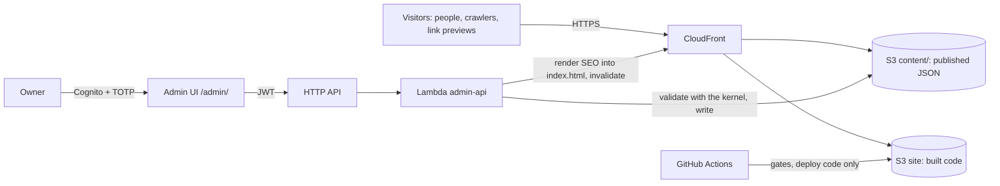

# Architecture

The living overview of how the code is organised and which rules are in force. Update it in the same change that moves a boundary. Reasoning lives in the ADRs (`docs/decisions/`) and in `specs/010-architecture/`; this page only states what is true now and what is next.

**Migration status (2026-10-12):** P0, P1 and P2a done. Next: P2b, P3 and P4, the normalization stage of ADR 007; content and release follow it, in that order. Phases are defined in `specs/010-architecture/spec.md`, section 7.

## System



Today only the left half exists in AWS (S3 and CloudFront, `infra/`). The admin runs locally (`server/`, NestJS) and publishes to disk; the Cognito path is ADR 004, in progress.

Two layers: the repository holds code and example content; the owner's content is private, gitignored locally (`public/content/site.{en,es}.json`, `visual.json`) and reaches the site only through the admin.

## Repository

| Path | What | Notes |
|---|---|---|
| `src/` | Public site: React 19, TypeScript, Vite, React Three Fiber, Tailwind v4 | One package with the admin server |
| `src/kernel/` | Content kernel: render schemas, publish rules and layout budgets (`publishRules.ts`, `layoutBudgets.json`), face and world catalogs, defaults (the bundled example), SEO renderer | ADR 005 |
| `server/` | Local NestJS admin, `127.0.0.1:5182` | Retired by ADR 004 slice 6; imports only `src/kernel`; linted and type-checked |
| `infra/` | AWS CDK | Own `package.json`, lockfile and TypeScript version |
| `scripts/` | Gate scripts (`check-*.mjs`) and their data in `scripts/checks/` | Known layout failures, budget ratchet, deploy test |
| `docs/`, `specs/` | Direction, ADRs, specs | `AGENTS.md` is the constitution |

## Site modules

**Today:** `src/kernel/` (content contract), `src/features/content/` (loaders, locale, sanitizer, `RichText`, content hooks), `src/styles/layoutModes.ts` (layout modes), `src/lib/` (`ErrorBoundary`, `hasWebGL`), and everything else under `src/features/premium-cube/` (one folder), plus `src/App.tsx`, `src/App.css`, `src/index.css`. `PremiumCubePrototype.tsx` owns most behaviour.

**Target** (ADR 006; folders appear in the phase noted):

```
src/
  app/               composition                                        P3
  features/
    experience/      store and typed events                            P3
    scene/           R3F scene, intro, worlds, environment              P3 (moved as is)
    faces/           rails, evidence, flow, research map, dialog        P3
    navigation/      face strip, language switch, contact links         P3
    content/         loaders, sanitizer, UI copy dictionary              done (loaders), P3
    audio/  dev/     ambient sound; diagnostics and showcase (DEV only)  P3
  ui/                Tailwind primitives                                P2b
  styles/            tokens.css, scene.css, layoutModes.ts              done (layoutModes), P2b
  lib/               React utilities any layer may use: ErrorBoundary   done
  kernel/            ADR 005                                            done
```

Dependency rules (target, linted from P3): `kernel` imports only `zod`; `lib` imports only React and anyone may import it; `ui` imports no feature, three or R3F; `scene` and the DOM features (`faces`, `navigation`) never import each other and meet in `experience`; `experience` imports only `kernel`; `app` may import everything.

## Flows

- **Build-time SEO.** `vite.config.ts` (`seoFromContent`) reads `public/content/site.en.json`, or the committed example if absent, and renders the head tags, JSON-LD and a plain-text body into `index.html` with `src/kernel/seo/renderSeo.ts`. CI has no private content, so a CI build carries the example identity.
- **Content at runtime.** The site renders the bundled example first, fetches `content/site.{locale}.json` and `content/visual.json` (`src/features/content/loadContent.ts`), validates them with the kernel, and keeps the example when a document is absent, not JSON or invalid. Empty fields of a published face are filled from the example in the same language.
- **Publish (today).** The local admin validates with `PublishableSiteContentSchema` (the render schema plus layout budgets, link rules and no example placeholders) and writes `public/content/*.json` on disk. Not production. The site itself loads with the tolerant render schema, so content published under older rules keeps rendering.
- **Publish (target, ADR 004).** Lambda validates with the kernel, writes to `content/` in the site bucket, renders SEO into `index.html`, invalidates.
- **Deploy.** `deploy.yml` builds, uploads the hashed `assets/` without deleting old chunks, then syncs the rest with `--delete` excluding `content/*` and `assets/*` (AD-11). **Known gap:** CloudFront still rewrites 403/404 to `index.html` with status 200 (AD-09); removed in the publish track, together with the lifecycle rule for old chunks.

## Rules and their gates

| Rule | Status | Gate |
|---|---|---|
| Personal data never in the repository | In force | `.gitignore`; `npm run check:privacy` in CI and pre-push (H-08a); `--history` before publishing a repository |
| Build, lint and unit tests pass | In force | CI |
| CDK synthesises | In force | CI |
| Server linted and type-checked | In force | `npm run lint`, `npm run typecheck:server` (H-05) |
| Kernel pure, server imports only the kernel | In force | `tsconfig.kernel.json` in `tsc -b`, lint rules in `eslint.config.js` (H-15, H-04b); the rules themselves are tested by `scripts/checks/boundaries.test.ts` |
| Owner content wins; a missing field falls back to the example in the same language | In force | `src/kernel/siteContent.test.ts` |
| Every public asset has a recorded source and licence | In force, two pending | `docs/assets.md`, `scripts/checks/assets.test.ts` |
| Layout: no rail over the strip, CTAs in view, name first and not covered | In force, no known failures | `npm run check:layout` (H-06) |
| Content within its layout budget fits every supported screen | In force | `npm run check:layout -- --content=stress` (H-06b); publish rules in `src/kernel/publishRules.ts`, tested by `scripts/checks/stressContent.test.ts` |
| One source for layout modes; no numeric breakpoints in components | In force | `src/styles/layoutModes.test.ts` (H-17) |
| No blank page without WebGL or when a world fails | In force | Degradation checks in `npm run check:layout` (H-18) |
| Accessibility: no axe violations | In force, no known failures | `npm run check:layout` (H-13) |
| First-view budget, ratchet | In force | `npm run check:budget`, limit in `scripts/checks/budget.json` (H-07) |
| Deploy never deletes content | In force | `scripts/checks/deployWorkflow.test.ts` (H-14) |
| No colour literals outside tokens | P2b | CI (H-08b) |
| Module boundaries | P3 | Lint (H-04) |
| DOM-layer files ≤ 250 lines | P3 | Script (H-16) |
| The served font is the one measured (Inter) | In force | `font-not-loaded` in `npm run check:layout` (AD-10) |
| Living docs carry no undated measurements | In force | `npm run check:docs` (H-11) |
| Architecture doc updated with boundary changes | Unchecked | PR template |
