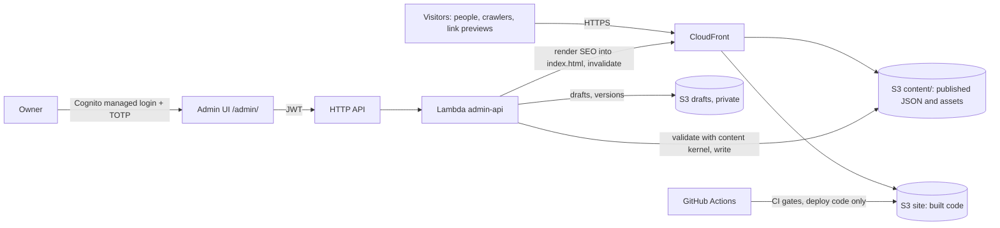

# 010: Architecture and Harness — Proposal

**Status:** revision 2 (2026-10-12), after the first independent audit (`audit-1.md`, verdict "approve with changes"). Accepted as ADR 005 and ADR 006; P0 done (2026-10-12), progress tracked in `docs/architecture.md`. Section 11 maps every audit finding to the change it produced.
**Owner decisions:** D-1 and D-3 decided; D-2, D-4, D-5 open (section 9), each with a recommendation.
**Outputs once accepted:** `docs/architecture.md` (living overview), ADR 005 (content kernel inside the site; workspaces deferred), ADR 006 (frontend architecture), harness changes in `AGENTS.md`, `CLAUDE.md` and CI.

## How to audit this document

Every claim about the current state carries an evidence id (`E-nn`) with the command or file that reproduces it. Every decision (`AD-nn`) lists the alternatives considered, the consequences and how compliance is verified. Every harness change (`H-nn`) names the gate that enforces it, or says **unchecked** when only review enforces it. A claim without evidence, a decision without a verification, or a rule presented as enforced without a gate is a finding.

**Baseline.** Evidence was measured on commit `7ac3a0c` plus the uncommitted first-glance and SEO work. Once that work is committed, the baseline is pinned to that commit and re-measured.

## 1. Problem

The code is about to become public in a new repository (the current one cannot be published; see D-5). Developers are a stated audience: they "inspect the repo and find clear architecture" (`AGENTS.md`, Audience 3). The product and infrastructure architecture are written down (ADR 001–004, `docs/deploy-aws.md`); the code architecture is not: no module boundaries, no styling rule, no state model, no failure handling, and no gates that keep any of it true.

The most urgent consequence is visible: on short desktop screens the side rails overflow (E-06). The plan must fix that **before** publishing, without turning the fix into a refactor that delays publishing (`AGENTS.md`, "Publish before building more"; ADR 002).

## 2. Current state (evidence)

| Id | Fact | Reproduce |
|---|---|---|
| E-01 | All site code lives under one feature folder, `src/features/premium-cube/` (38 files, 35 without tests); outside it are `src/seo/` and the root files `App.tsx`, `main.tsx`, `App.css`, `index.css`. | `find src/features/premium-cube -type f \| wc -l` |
| E-02 | `PremiumCubePrototype.tsx` is 492 lines with 36 React hook calls, 7 of them effects; it owns face selection, panel transitions, the detail modal, the intro stages, the hint, touch detection, viewport size, URL sync, diagnostics and layout. | `grep -oE "\buse(State\|Ref\|Effect\|Callback\|Memo)(<\|\()" <file> \| wc -l` |
| E-03 | No component uses Tailwind utility classes; the interface is styled by `src/App.css`, 1,697 hand-written lines. | `grep -rlE 'className="[^"]*\b(flex\|grid)\b' src` returns nothing; `wc -l src/App.css` |
| E-04 | Colours are defined in at least five places: Tailwind `@theme` and `:root` in `src/index.css`; `App.css` (155 `rgba()` literals, 119 distinct, and 15 hex literals, 8 distinct); the inline `<style>` in `index.html`; `src/seo/renderSeo.ts` (`theme-color`); per-face accents in `cubeSections.ts` and in `visual.json`, which is owner-editable content (ADR 003). | `grep -oE "rgba\([^)]*\)" src/App.css \| sort -u \| wc -l`; `grep -oE "#[0-9a-fA-F]{3,8}\b" src/App.css` |
| E-05 | Breakpoints are ad hoc: 11 media queries over 8 conditions, none height-based. The stacked breakpoint is also duplicated in JavaScript and disagrees at the edge: CSS stacks at `max-width: 900px` (`App.css:214`), the shell at `width <= 900` (`PremiumCubePrototype.tsx:332`), the scene at `width < 900` (`CubeScene.tsx:243`). At exactly 900 px the DOM stacks and the scene does not. | `grep -o "@media[^{]*" src/App.css \| sort \| uniq -c`; the two lines cited |
| E-06 | Short desktop viewports overflow. Measured at 1600×725 (`es`): the AGENTIC rail enters the face strip by 17 px, RESEARCH by 148 px with its CTA outside the viewport; three other faces end 2 px from the strip. In `en`, AGENTIC overlaps by 62 px. RESEARCH also overflows at 1366×768 and 1280×720 in both locales, AGENTIC at 1280×720 in `es`. It reproduces with the committed example content. | `audit-1.md` E-06 probe (Playwright, SwiftShader, `vite preview`) |
| E-07 | The admin imports two site modules (`siteContent`, `visualContent`), which pull in `cubeSections.ts` and the scene's `catalog.ts`. The server does not type-check today: `siteContent.ts(211,44): Cannot find name 'window'`. | `grep -rn "\.\./\.\./src" server`; `npx tsc --noEmit -p server/tsconfig.json` |
| E-08 | Default content exists three times: `cubeSections.ts` (includes copy), `DEFAULT_CONTENT` in `siteContent.ts`, and the committed example JSON. `normalizeSections` fills missing fields from the English `CUBE_SECTIONS`, so an incomplete Spanish face shows English text. | Read the three files |
| E-09 | UI copy is hard-coded in components: `HINT_COPY`, two `locale === 'es' ? … : …`, English `aria-label`s ("Premium cube prototype", "Cube sections", "Language", "Research concepts"), and `getEyebrowLabel` (`SidePanels.tsx:223`), which ignores the content's Spanish `eyebrow` and substitutes fixed labels. | `grep -rn "HINT_COPY\|locale === 'es' ?\|aria-label=\"[A-Z]" src`; `SidePanels.tsx:223-237` |
| E-10 | `server/` is neither linted nor type-checked in CI and has no tests. Run by hand: ESLint reports 7 errors, `tsc` 1 error (E-07). Its tsconfig sets `strict: false` and `transpileOnly`. | `npx eslint --no-ignore server`; `server/tsconfig.json` |
| E-11 | One `package.json` holds the site and the NestJS admin with its drivers; `infra/` has its own `package.json`, lockfile and TypeScript 5.6 (root: 6.0). | `package.json`, `infra/package.json` |
| E-12 | First load ships 851 KB + 381 KB of JavaScript (245 + 103 KB gzip), 37 KB of CSS and a 1 MB environment photo (`public/environments/udec-frontis.jpg`) loaded on every visit. Seven scene chunks are already lazy (1–14 KB each). | `npm run build`; `ls -la dist/assets dist/environments` |
| E-13 | CI gates: lint, unit tests, build, CDK synth. No layout, accessibility, privacy or budget check. `deploy.yml:35` runs `aws s3 sync dist/ … --delete` without excluding `content/`, so a code deploy would delete published content. `AGENTS.md` states the opposite as a fact; it is ADR 004 task 1, pending. | `.github/workflows/ci.yml`, `.github/workflows/deploy.yml` |
| E-14 | The old rule "the name must be the most prominent text" had no check and the layout contradicted it. Resolved by D-3 (b); `AGENTS.md` amended (uncommitted). | `AGENTS.md` Direction |
| E-15 | Docs carry stale facts: `docs/roadmap.md` cites a 1.36 MB bundle and a 3,047-line `App.css`, and lists dead code (`ENABLE_FULLSCREEN_SECTION`, `securityWorld.tsx`) that no longer exists. | `docs/roadmap.md`; `grep -rn ENABLE_FULLSCREEN_SECTION src` |
| E-16 | Well structured today: the vector worlds (`catalog.ts` pure metadata, `registry.ts`, one file per world, lazy chunks), the pure intro timeline with tests, the build-time SEO renderer with tests. The Zod schemas are shared but not isolated: they import copy and the scene catalog, and `siteContent.ts` touches `window`. All 35 unit tests pass. | `npm test`; `grep "^import" src/features/premium-cube/content/*.ts` |
| E-17 | No error boundary exists. Without WebGL the `Canvas` throws and React unmounts the whole page. CloudFront answers 403/404 with `index.html` and status 200 (`infra/lib/static-site-stack.ts:33-36`); after a deploy deletes old chunks, an open page that lazy-loads a world receives HTML and crashes. | `grep -rn ErrorBoundary src` returns nothing; the stack file |
| E-18 | The font is declared but not served: `--font-sans: Inter, ui-sans-serif, …` with no `@font-face`. Every platform renders different metrics, so a layout measured on one machine does not hold on another. | `src/index.css:11`; `grep -rn "@font-face\|woff" src index.html` |
| E-19 | The content schema has no layout budgets (`AGENTS.md` asks for `label` ≤ 13 characters, 3–4 `features`, one concrete link per face) and does not validate `href` schemes. | `src/features/premium-cube/content/siteContent.ts` |
| E-20 | Commit author metadata in the current history contains the owner's personal email. Publishing that history publishes the address. | `git log --format=%ae \| sort \| uniq -c` |
| E-21 | The environment photo (E-12) has no recorded source or licence. | `public/environments/`; `docs/` |

## 3. Drivers (ranked)

1. **Privacy by construction.** Public code, private content (ADR 004). Personal data must be hard to commit, and deploys must not destroy content.
2. **Publish soon.** The site goes live with real identity and links before more architecture or features (ADR 002). The plan is ordered by this driver.
3. **First impression.** The cube and the name in the first seconds, on every viewport visitors use, including short laptop screens.
4. **Resilience.** No visitor ever sees a blank page: without WebGL, after a deploy, or when a scene chunk fails.
5. **Legibility of the public repo.** A developer finds the structure in minutes; agents find the rules without reading everything.
6. **Accessibility and machine readability.** Semantic HTML, static SEO, no information only inside WebGL.
7. **Performance.** A first view that loads fast on an average laptop and phone connection.
8. **Proportion.** One maintainer working with agents. No package, framework or structure the current problem does not need.

## 4. Non-goals

- No visual redesign. The cube stays centred on its platform; the worlds and the open layout stay. ADR 001–003, spec 003 and `docs/visual-direction.md` govern how it looks.
- No change of stack (React, TypeScript, Vite, R3F, Tailwind v4, Zod, CDK).
- No npm workspaces yet (AD-01).
- No rewrite in one step. Every phase leaves the site working and deployable.
- The 3D scene code is not restyled with Tailwind; it is scene code.

## 5. Target architecture

### 5.1 System context and containers



The repository holds everything on the left of the content buckets; nothing personal crosses into it. **Target invariant, not yet true (E-13):** a code deploy never deletes or overwrites content. AD-11 makes it true and gates it.

### 5.2 Repository layout (AD-01)

The structure stays a single package. The content kernel gets its own folder inside the site, at the path it will keep:

```
src/
  kernel/          the content kernel (5.3); the only path the admin may import
  app/  features/  ui/  styles/      the site (5.4)
server/            local NestJS admin, retired by ADR 004 slice 6; imports src/kernel only
infra/             AWS CDK, its own package and lockfile (unchanged, out of scope)
docs/  specs/
```

**Decision:** npm workspaces are deferred until a second real consumer exists: the Lambda `admin-api` (ADR 004 task 3). That change gets its own ADR then. Today the consumers are the site, its own Vite plugin (same package) and a server that will be deleted; moving them into workspaces is work for consumers that do not exist yet (audit A-09).

- **Alternatives:** (a) workspaces now (revision 1); (b) kernel folder now, workspaces with the Lambda (chosen).
- **Consequences:** one relative import path survives (`server/` → `../src/kernel`), sanctioned and lint-guarded; `infra/` keeps its own toolchain.
- **Verification:** H-04b (the server may import only `src/kernel`); H-15 (kernel purity).

### 5.3 The content kernel (`src/kernel/`, AD-02)

Single owner of the content contract, pure TypeScript with no DOM: Zod schemas and inferred types, the face catalog (ids, order, glyph ids; data only), the example content, one set of defaults derived from the example (closing E-08), the SEO renderer (moved from `src/seo/`), and the layout budgets. It depends on `zod` only.

Out of the kernel, because they need a DOM or a browser: `sanitizeRichText` (DOMPurify) and the loaders that read `window`/`navigator`. They move to `features/content`. The future Lambda brings its own sanitizer setup.

**Layout budgets and link rules live in the schema** (closing E-19): `label` ≤ 13 characters, 3–4 `features`, maximum lengths for summary and flow steps (set from the layout measurements in P2a, not by guess), at least one absolute `href` per face, and `href` restricted to `https:`, `mailto:` and relative paths. Content that would overflow or link unsafely is rejected when published.

- **Alternatives:** keep schemas inside the feature; a separate package (deferred with AD-01).
- **Consequences:** the admin and the Vite plugin import one path; the kernel can run in Node, the browser and a Lambda.
- **Verification:** H-15, a `tsc` pass over `src/kernel` with `lib` lacking `DOM`; schema unit tests for every budget and link rule.

### 5.4 Site modules (AD-03)

```
src/
  app/               composition only: providers, page assembly, error boundaries, routes later
  features/
    experience/      state of the experience (active face, transitions, intro stage, hint)
    scene/           R3F: CubeScene, PremiumCube, intro, worlds, environment (moved as is)
    faces/           DOM presentation of a face: rails, evidence list, flow, research map, detail dialog
    navigation/      face strip, language switch, contact links
    content/         loading, locale resolution, sanitizer, UI copy dictionary
    audio/           the opt-in ambient sound (no autoplay)
    dev/             diagnostics and the vector-world showcase (development only, excluded from production by an `import.meta.env.DEV` guard)
  ui/                presentational primitives with Tailwind: Button, IconLink, Eyebrow, Rail, Glyph, Dialog
  styles/            tokens.css, scene.css
  kernel/            5.3
```

Dependency rules, enforced by lint from P3, when the folders exist (H-04):

| From | May import | Must not import |
|---|---|---|
| `kernel/` | `zod` | anything else in `src`, React, three |
| `ui/` | `styles`, React | `features/*`, three, R3F |
| `features/scene` | `features/experience`, `kernel`, three, R3F | `features/faces`, `features/navigation`, `ui/` |
| `features/faces`, `features/navigation` | `features/experience`, `features/content`, `ui/`, `kernel` | `features/scene`, three, R3F |
| `features/experience` | `kernel` | any other feature, `ui/` |
| `app/` | everything | — |

The scene and the DOM never import each other; they meet in `features/experience`. Imports across top-level folders use the `@/` alias; `../../` between features is forbidden, which keeps `no-restricted-imports` patterns robust. Known limits of that rule (audit A-15): it does not see dynamic `import()`, which is allowed only inside `features/scene`, guarded by a `no-restricted-syntax` rule for `ImportExpression` elsewhere.

### 5.5 State and events (AD-04)

One experience store per page: a pure reducer with typed events (`faceRequested`, `faceEntered`, `transitionFinished`, `introPhaseChanged`, `visitorEngaged`, `detailOpened`, `detailClosed`, `localeChanged`) behind a small external store read with `useSyncExternalStore`, so components subscribe to slices and do not re-render on every event. Per-frame values (pointer, drag, intro clock) stay in refs inside the scene, as today.

- **Alternatives:** `useReducer` plus context (re-renders every consumer on each dispatch; acceptable given rare events, rejected for the selector API it cannot give); a state library (rejected, driver 8).
- **Verification:** reducer unit tests; the DOM layers (`app/`, `faces/`, `navigation/`, `ui/`) have no file over 250 lines, checked by a script (H-16). Scene files are exempt: they move as is.

### 5.6 Styling (AD-05)

- Tailwind v4 utilities in JSX for layout, spacing, typography and states.
- `styles/tokens.css` defines the named tokens (colours, fonts, z-index layers, motion durations) with their default values. **Per-face accents keep their runtime source** (ADR 003): `visual.json`, validated by the kernel as hex colours, sets CSS custom properties at runtime; `tokens.css` only declares their names and defaults.
- Hand-written CSS only where utilities are poor: the canvas, the rail scrims (gradients, masks), keyframes, the intro reveal. It lives in `styles/scene.css` or next to its component, each block commented with why it is not a utility.
- Variants of a primitive are a typed props-to-classes map in the component, joined with a local `cx` helper. No `clsx`, `cva` or `tailwind-merge` until a real conflict appears.
- **Verification:** H-08b, no colour literal outside `tokens.css`, scene code and the `visual.json` path (from P2b, when the token file exists).

### 5.7 Layout modes and the auto-fit (AD-06)

Three modes:

| Mode | Media query | Behaviour |
|---|---|---|
| `stacked` | `(max-width: 900px), (max-aspect-ratio: 4/3)` | cube on top, rails below in page flow (today's mobile layout; the page scrolls by design) |
| `desktop` | `not ((max-width: 900px) or (max-aspect-ratio: 4/3))` — the exact complement of `stacked` (Media Queries Level 4 syntax, supported by current evergreen browsers; checked in P2a) | cube centre, rails left and right, strip at the bottom |
| `desktop-short` | `desktop` and `(max-height: 820px)` | same layout, compacted (below) |

**One source for the queries:** `src/styles/layoutModes.ts` exports the strings. JavaScript uses them through one `useLayoutMode()` hook (`matchMedia`), replacing the three numeric checks of E-05. CSS uses the same strings: until P2b as plain `@media` rules in the current CSS, from P2b as Tailwind `@custom-variant` in **block form** (`@custom-variant stacked { @media …, … { @slot; } }`). The short form generates invalid CSS for `OR` conditions (verified with Tailwind 4.3.0, audit A-06). A unit test (H-17) reads the CSS and checks that every mode query matches `layoutModes.ts`.

**What `desktop-short` compacts, declared, not ad hoc:**

1. vertical sizes already use `clamp()` with height units, so they shrink continuously;
2. the face title steps down one size;
3. feature descriptions in the left rail and flow step descriptions in the right rail are hidden (titles stay);
4. gaps tighten to the short spacing token.

Elements carry `data-priority="secondary"` for item 3, so the rule is one selector.

**Safety net:** each rail has a `max-height` equal to the space between the header and the strip, with internal scroll. Content that still does not fit stays reachable and never covers the strip. The budgets of 5.3 make this the exception; the layout check (H-06) reports any rail that needs it.

- **Alternatives:** JS measurement and scaling (rejected: layout thrash, and it hides content problems instead of bounding them); one breakpoint per screen size (rejected: unbounded).
- **Verification:** H-06 across the matrix; H-17.

### 5.8 UI copy and i18n (AD-07)

Owner-editable text stays in the content documents; **content wins** (the `getEyebrowLabel` override of E-09 is removed). Interface strings that are not content (hint, close, language labels, every `aria-label`) move to one typed dictionary per locale in `features/content/copy.ts`. Missing Spanish content falls back to the Spanish example, never to English (E-08).

- **Verification:** a unit test that both dictionaries have the same keys; a lint rule (`no-restricted-syntax`) that forbids `locale === 'es'` comparisons outside `features/content`.

### 5.9 Routes (AD-08)

The single-screen home stays route-less. A router arrives with the methodology page (roadmap priority 3), with one static HTML file per route rendered by the kernel's SEO renderer. Not before.

### 5.10 Degradation (AD-09)

No visitor sees a blank page:

- **No WebGL or a scene error:** an error boundary around the `Canvas` replaces it with a static poster (the share image, 92 KB, already built). The name, rails and strip stay, because they are DOM.
- **A world fails to load:** a boundary around each lazy world falls back to the plain backdrop; the cube stays.
- **Deploys keep old chunks:** the code deploy does not delete `assets/` (hashed names never collide); a lifecycle rule removes chunks older than 30 days.
- **No SPA fallback while there are no routes:** the distribution stops rewriting 403/404 to `index.html` with status 200; a missing chunk returns an honest 404 that the boundary catches. AD-08 brings routing back with a scoped CloudFront Function.

- **Alternatives:** a global boundary only (rejected: it would blank the DOM content too).
- **Verification:** H-18, a Playwright test with WebGL disabled asserts the `h1`, both rails and the strip are visible; a unit test of the boundaries; a CDK assertion test that `errorResponses` is absent.

### 5.11 Typography (AD-10)

Serve Inter as a self-hosted variable `woff2`, Latin subset (about 30–50 KB), preloaded, `font-display: swap`, with metric overrides on the fallback to limit layout shift. The layout check waits for `document.fonts.ready`. With the font served, the measurement in CI (Linux) holds on visitors' machines (closing E-18).

- **Alternatives:** keep the system stack (rejected: no layout test can represent visitors); Google Fonts (rejected: a third-party request and privacy on every visit).
- **Verification:** the layout check fails if `document.fonts.check('1em Inter')` is false; the font counts in the first-view budget (H-07).

### 5.12 Deploy invariants (AD-11)

- The code deploy excludes `content/*` and does not delete `assets/*`: `aws s3 sync dist/ s3://… --delete --exclude "content/*" --exclude "assets/*"` followed by a non-deleting sync of `assets/`.
- Owned by ADR 004 task 1; gated here because it protects driver 1.
- **Verification:** H-14, a unit test that parses `deploy.yml` and fails if any `s3 sync … --delete` lacks the `content/*` exclusion.

### 5.13 Cross-cutting

- **First-view budget (H-07):** everything loaded before the first face is interactive (entry JavaScript and its static imports, CSS, the font, the environment photo), measured from the build manifest. It is a ratchet: the CI limit is the last accepted value, and it can only go down unless a spec raises it. The 1 MB environment photo is the first candidate to reduce; its source and licence get recorded (E-21).
- **Security headers:** a CloudFront response headers policy (HSTS, frame-ancestors, referrer policy, CSP). The CSP allows the inline script and the inline style of `index.html` by hash, computed at build time. A test compares `dist/index.html` against the policy. The admin path gets its own policy (`connect-src` for Cognito and the API). Ship in `Report-Only` first. The hashes must survive the Lambda's re-render of `index.html` (ADR 004 slice 5): the Lambda uses the same renderer and recomputes them.
- **Privacy (H-08a):** see the harness.
- **Measurement:** D-2.

## 6. Harness changes

The harness is what keeps agents and the owner inside the architecture: the documents they read and the gates that fail when they drift. **Unchecked** means only review enforces it, and it is labelled so in `AGENTS.md`.

| Id | Change | Enforced by | Phase |
|---|---|---|---|
| H-01 | `AGENTS.md` stays the constitution and gains a short **Architecture rules** section (kernel rule, dependency table, styling rule, layout modes, degradation, deploy invariants), each linked to `docs/architecture.md`; detail moves out of `AGENTS.md`. Rules without a gate say "unchecked". | Unchecked; the rules it lists are gated by H-04 to H-18 | P0 |
| H-02 | `docs/architecture.md`: the living overview (diagrams, module map, publish and deploy flows), updated in the same change that moves a boundary. | Unchecked; PR checklist (H-09) | P0 |
| H-03 | `CLAUDE.md`: "read `docs/architecture.md` before changing code" and the definition of done (H-10). | Unchecked | P0 |
| H-04 | Boundary lint: `no-restricted-imports` per folder with the `@/` alias, `../../` between features forbidden, `ImportExpression` restricted to `features/scene`. **H-04b**, from P1: `server/` may import only `src/kernel`. | `npm run lint` in CI | P1 (H-04b), P3 (H-04) |
| H-05 | Lint and type-check the server in CI (closes E-10); fix its 7 ESLint errors; the `window` error disappears with AD-02. | CI | P1 |
| H-06 | **Layout check** (Playwright, DOM geometry, no pixel diffs), one page per viewport, faces changed by click, after `document.fonts.ready`. Assertions by mode. **`desktop`/`desktop-short`:** no rail box intersects the strip; every CTA is inside the viewport; no rail needed its internal scroll (warning, not failure). **`stacked`:** after scrolling to the end, no CTA lies under the fixed strip. **All modes:** the name is the page's `h1`, starts in the top-left quarter and is not covered (`elementFromPoint`). Contrast of the name is computed against the declared scrim token, not sampled from WebGL. **Matrix:** every PR runs 1600×725, 1366×768, 390×844; the full matrix (adds 2048×1152, 1920×1080, 1440×900, 1280×720, 768×1024) runs nightly and before publishing. WebGL via `--use-angle=swiftshader --enable-unsafe-swiftshader`. | CI job `layout` | P1 |
| H-06b | The same check runs locally against the **private** content before every publish (`npm run check:layout -- --content private`), and in CI against a committed **stress fixture**: both locales, every field at its schema maximum. | Publish checklist; CI | P2a |
| H-07 | First-view budget as a ratchet (5.13). | CI | P1 |
| H-08 | **H-08a privacy:** scans `git ls-files` content, the author metadata of the history to be published, and a local, gitignored denylist of real values (spec 002). **H-08b tokens:** no colour literals outside `tokens.css`, scene code and the `visual.json` path. | CI (H-08a also as a pre-push hook) | P1 (a), P2b (b) |
| H-09 | `.github/pull_request_template.md`: spec or ADR link, gates run, screenshots for visual changes, architecture doc updated if a boundary moved. | Unchecked | P0 |
| H-10 | Definition of done: build, lint, type-check, unit tests, layout check, accessibility check, privacy check, visual verification on desktop and at 390 px for visual changes. | CI plus `CLAUDE.md` | P0 |
| H-11 | Docs hygiene: metrics in docs carry a date or the command that produces them; a script flags size and line-count figures in `docs/` without either (closes E-15). | CI | P1 |
| H-12 | Working method written down: spec → independent audit by an agent without context → revision → build → gates → visual verification → Conventional Commit in Spanish. It is part of the methodology the site presents; `audit-1.md` is its first record. | Unchecked; `AGENTS.md`, `specs/README.md` | P0 |
| H-13 | Accessibility: `@axe-core/playwright` inside the layout job; existing violations recorded as known, nothing new allowed. | CI job `layout` | P1 |
| H-14 | Deploy invariant test (AD-11). | CI | P1 |
| H-15 | Kernel purity: `tsc` over `src/kernel` with no `DOM` lib; lint forbids imports from outside the kernel. | CI | P1 |
| H-16 | File-size script for the DOM layers (AD-04). | CI | P3 |
| H-17 | Layout-mode sync test (AD-06). | CI | P2a |
| H-18 | Degradation tests (AD-09). | CI | P2a |

## 7. Migration plan

Ordered by driver 2. Every phase ends with every gate green and the site working; visual changes only where the phase says so.

| Phase | Content | Exit criteria |
|---|---|---|
| **P0 Docs** | Apply this revision; `docs/architecture.md`, ADR 005, ADR 006; H-01, H-02, H-03, H-09, H-10, H-12; update the stale roadmap facts (E-15). | D-1 decided (done); D-2 and D-5 are needed only before the publish track. |
| **P1 Minimum gates and kernel** | Commit the pending work and pin the baseline. Create `src/kernel/` (schemas without `window`, catalog data, example, defaults, SEO renderer); loaders and sanitizer move to `features/content`. Server lint and type-check (H-04b, H-05). Layout check against today's site, failures recorded as known (H-06); accessibility baseline (H-13); first-view budget (H-07); privacy check (H-08a); deploy test (H-14, which fails until AD-11 lands, recorded as known); kernel purity (H-15); docs script (H-11). | The new CI jobs run; known failures are listed; nothing new fails. |
| **P2a Fit and resilience (before publishing)** | `layoutModes.ts` and `useLayoutMode()` replacing the three numeric checks; the `desktop-short` mode and the safety net in the current CSS; Inter served (AD-10); schema budgets and link rules, measured from the layout check; stress fixture (H-06b); error boundaries and poster (AD-09); content wins over `getEyebrowLabel`; Spanish fallback (AD-07, the two bug fixes only). | Layout check green on the full matrix with the example content and the stress fixture (E-06 closed); H-17, H-18 green; screenshots at 1440×900 and 390×844 unchanged except the fixed overflow. |
| **Publish track** (ADR 004 and the roadmap, not this spec) | Deploy invariants and no SPA fallback (AD-11, AD-09 infra part); real content through the admin; H-06b against the private content; the new public repository (D-5); first publish. | Site live with real identity and links. |
| **P2b Styling** | `styles/tokens.css` (tokens, accents runtime, modes as block-form custom variants); `ui/` primitives for the header and rails; migrate header and both rails to Tailwind; H-08b. | `App.css` loses the migrated rules; layout check and screenshots unchanged. |
| **P3 Experience state** | The store (AD-04); split `PremiumCubePrototype.tsx` into `app/` and features; full copy dictionary (AD-07); boundary lint (H-04); H-16. | Reducer tests; no DOM-layer file over 250 lines; behaviour checks (intro, skip, face change, dialog focus) pass. |
| **P4 Finish** | Remaining components to Tailwind; `<dialog>` for the detail view; security headers (5.13), `Report-Only` then enforced; reduce the environment photo. | `App.css` gone or reduced to documented exceptions; CSP enforced without reports. |

Workspaces are not a phase: they come with the Lambda (AD-01). Feature work (evidence per face, contact links) follows P2a: it needs the schema budgets and the safety net, nothing later.

### Known trade-off for the owner

P2a adds the short mode and the safety net to the hand-written `App.css`, against the stated preference for Tailwind. It is about 60 lines, uses the final `layoutModes.ts` queries, and P2b migrates it with the rest. The alternative, migrating the rails to Tailwind first, delays the fix that blocks publishing by the whole styling migration.

## 8. Risks

| Risk | Mitigation |
|---|---|
| The plan still delays publishing. | Only P1 and P2a precede the publish track; both are bounded and each has an exit criterion. |
| Software WebGL in CI is slow (5–14 s per load, audit A-10). | One page per viewport, three viewports per PR, full matrix nightly; geometry only. |
| The private content overflows although CI is green. | Schema budgets reject it at publish; H-06b runs against it before publishing; the safety net keeps it reachable. |
| Visual regressions while moving CSS to utilities (P2b, P4). | Per component, before/after screenshots at fixed viewports, the layout check as a net. |
| Schema budgets reject content the owner wants. | Budgets come from measurements; changing one is a reviewed spec change, not a silent edit. |
| The CSP breaks the page. | `Report-Only` first; the hash test fails before deploy. |

## 9. Owner decisions

| Id | Question | Options | Recommendation |
|---|---|---|---|
| D-1 | Where does the shared kernel live? | (a) npm workspaces now; (b) `src/kernel/` now, workspaces with the Lambda | **Decided (b)** on 2026-10-12, revised after the audit (A-09): two real consumers today, one of them retiring. |
| D-2 | Measure visits? | (a) CloudFront standard logs; (b) a privacy-friendly analytics script; (c) CloudFront's built-in reports only, no logs; (d) none | **(c)**, revised after the audit (A-21): standard logs hold IP addresses, which are personal data needing retention rules; the console reports (top referrers, popular objects) may be enough to see whether recruiters arrive. Confirm against current AWS documentation before relying on it. |
| D-3 | The "name is the most prominent text" rule | (a) keep; (b) amend: first read, not largest | **Decided (b)** on 2026-10-12; `AGENTS.md` amended. |
| D-4 | Order against publishing | (a) P0, P1, P2a, publish track, then P2b–P4; (b) all phases before publishing | **(a)**: only what fixes the visible overflow and the blank-page cases precedes publishing. |
| D-5 | History of the public repository | (a) a fresh repository with one initial commit authored with the GitHub `noreply` address; (b) publish the current history rewritten | **(a)**: the current history carries the personal email (E-20), and the current repository holds a pull-request reference with private data that cannot be deleted; a clean start is simpler and verifiable by H-08a. |

## 10. Questions for the next audit

1. Does every finding of `audit-1.md` have a resolution in section 11 that holds against the code?
2. Is P2a sufficient to close E-06 for the private content too, given H-06b and the safety net?
3. Is any gate still too expensive for one maintainer (H-06, H-13, H-07)?
4. Are the degradation decisions (AD-09) correct for CloudFront and S3 as configured in `infra/`?
5. Is anything still presented as enforced that only review enforces?

## 11. Audit resolution (`audit-1.md`)

| Finding | Resolution |
|---|---|
| E-02 count wrong; E-03 command broken | Corrected (E-02: 36; E-03: `grep -rlE`). |
| E-04, E-05, E-07–E-13, E-15, E-16 incomplete | Completed in section 2; new E-17 to E-21. |
| A-01 P2 ties the blocking fix to a migration | P2 split: P2a before publishing, P2b after; D-4 reordered; publish track placed. |
| A-02 layout tests cannot prove real content fits | AD-10 typography; stress fixture and private-content check (H-06b); schema budgets from measurements; safety net (AD-06). |
| A-03 blank-page failure modes | AD-09, H-18. |
| A-04 deploy deletes content, presented as fact | Marked as target invariant (5.1); AD-11; H-14. |
| A-05 accents contradict ADR 003 | AD-05: accents keep their runtime source; tokens declare names and defaults. |
| A-06 modes cannot be declared once in CSS | AD-06: `layoutModes.ts` single source, block-form variants, exact complement, H-17. |
| A-07 kernel not DOM-free | AD-02: sanitizer and loaders leave the kernel; H-15. |
| A-08 P1 cannot pass without P4 | Kernel extraction moved into P1, which removes the `window` error; ESLint errors fixed in P1. |
| A-09 workspaces heavier than the problem | D-1 revised to (b); workspaces with the Lambda; `infra/` explicitly out. |
| A-10 H-06 cost, determinism, stacked mode | Per-mode assertions, reduced PR matrix, nightly full matrix, contrast against the scrim token, SwiftShader flags. |
| A-11 `useReducer` + context lacks selectors; 250-line rule contradicts the scene | `useSyncExternalStore`; rule limited to DOM layers and scripted (H-16). |
| A-12 accessibility barely gated | H-13 axe; `aria-label`s into the dictionary; `<dialog>` in P4. |
| A-13 privacy check scans the wrong thing; history; asset provenance | H-08a redefined; D-5; E-21 and provenance in 5.13. |
| A-14 CSP coverage | 5.13: style hash, admin policy, build-time hashes with test, `Report-Only`, Lambda recomputes. |
| A-15 `no-restricted-imports` gaps | Alias, `../../` forbidden, `ImportExpression` rule; H-04 moved to P3, H-04b in P1. |
| A-16 baseline not pinned | Baseline note; pinned in P1. |
| A-17 wrong reference for the new repository | Section 1 points to D-5. |
| A-18 budget counts only JS | H-07 first-view ratchet including CSS, font and photo. |
| A-19 overlap with spec 003; matrix lacks 2048 px | Spec 003 named in non-goals; 2048×1152 added to the full matrix. The "Tailwind for static pages and future admin UI" limit in `docs/visual-direction.md` is superseded by AD-05 once ADR 006 is accepted. |
| A-20 D-3 shown pending; priority undefined; modules missing; `src/seo` move | D-3 decided; priority defined in AD-06; `audio/` and `dev/` added; `src/seo` moves to the kernel in P1. |
| A-21 CloudFront logs are personal data | D-2 revised to (c). |
| A-22 review-only rules not labelled | "Unchecked" labels in section 6; H-11 scripted. |
| A-23 `href` not validated | AD-02 link rules. |

## 12. Implementation notes

What the build changed against this plan, so the next audit compares the code with the decisions as built.

**P1 (2026-10-12)**

- E-08 and E-09 were fixed while extracting the kernel: the defaults are the bundled example, a face falls back in its own language, and the eyebrow comes from the content.
- AD-11 (deploy) was done in P1 instead of the publish track: two lines, and its test (H-14) passes from the start.
- The content loaders accept only JSON responses, so a missing private document is silent.

**P2a (2026-10-12)**

- `desktop-short` is `max-height: 900px`, not 820: measured, 1536×864 (a 1920×1080 screen at 125% scaling) overflowed at 864. 1536×864 joined the full matrix.
- Compaction first, hiding last. Feature and flow descriptions stay; the only `secondary` lines are the research concept summaries, which their dialog repeats. Hiding all descriptions was measured and rejected: 1366×768 fitted without it.
- The safety net grew two rules found with the stress content: the face strip never wraps on desktop (the owner's full name truncates instead), and the rail's call to action is `sticky`, so a rail that scrolls still shows it.
- Budgets are publish rules, not render constraints: `PublishableSiteContentSchema` (admin) extends the tolerant `SiteContentSchema` (site), so content published under older rules keeps rendering instead of silently falling back to the example (finding of the admin audit, 2026-10-10). They count visible characters, not inline markup. With every field at its limit and Inter served, rails fit without scrolling from 768 px of height up; below it they scroll by up to 30 px at 1600×725 and 41 px at 1280×720 (a warning; the call to action stays visible). Cutting further would force copy shorter than the example's. The summary budget was cut to 112 visible characters to get there. The example content fits every size without scrolling.
- Without WebGL, three.js fails inside React Three Fiber's asynchronous setup, which no error boundary sees; the shell checks `hasWebGL()` before mounting the canvas. React Three Fiber also reports caught errors through `window.reportError`, so the degradation check asserts the boundary caught the failure rather than the absence of page errors.
- `src/lib/` was added for React utilities every layer may import (`ErrorBoundary`, `hasWebGL`): the scene needs a boundary and may not import `app/` or `ui/`.
- The first-view budget rose by 47 KB for Inter, as AD-10 foresaw; the raise is recorded in `scripts/checks/budget.json`.
- H-06 measures the geometry without WebGL. On the 2-CPU CI runner the software-rendered scene starved the page's main thread and Playwright could not query it (the page itself rendered correctly). The geometry is DOM and the still image takes the canvas's place, so nothing is lost; the scene is exercised by the degradation check with software WebGL. Walking the faces without WebGL exposed a real defect, fixed: without a scene the face strip could not change faces.
- Not done in P2a: font metric overrides for the fallback (layout shift while Inter loads), and the CloudFront part of AD-09 (publish track).
